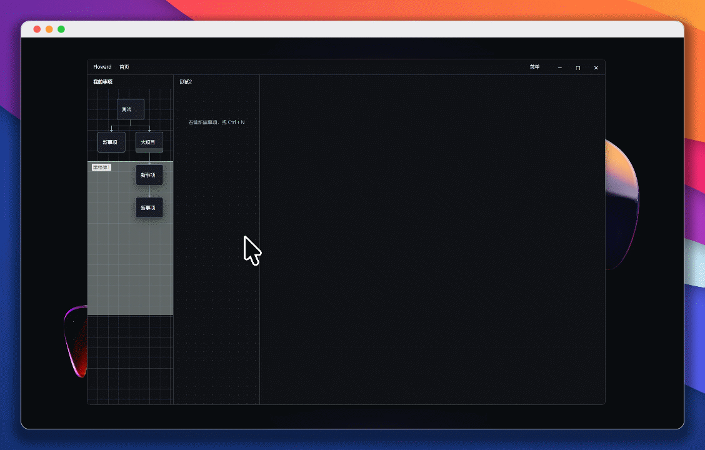
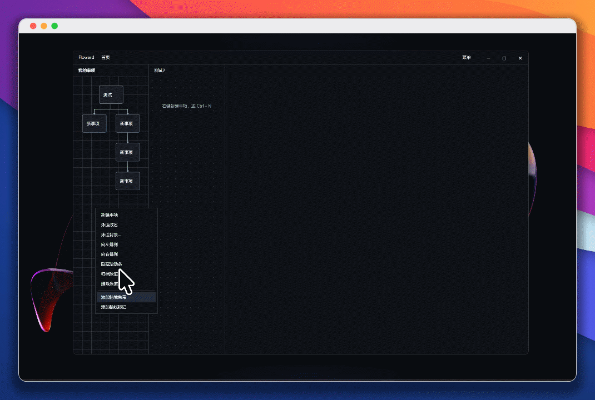

  

<h1 align="center">顺水意流 · floward</h1>

<strong>用事项和连线，把想做的事展开成下一步。</strong>

Windows 桌面规划工具 · 本地保存 · 离线使用

简体中文 · <a href="README.en.md">English</a>

  <a href="#features">功能与演示</a> ·
  <a href="#start">下载与使用</a> ·
  <a href="#why">为什么做、相关研究</a> ·
  <a href="#credits">致谢、License</a>

  
  
  

我在电脑前研究一个想做的小工具，浏览器里开着同类产品、教程和几篇资料，笔记里也记了不少想法。几个晚上过去，我对它应该是什么样越来越有把握，却还没有拿出任何东西给别人试。再打开项目时，眼前又有一堆可以继续研究的问题，反而说不清今天究竟先做哪一件。

我开始想，能不能先写一页说明，找两个人照着试一次？这需要分别准备说明和试用邀请，等两边都准备好，再看看别人会在哪里卡住。有了实际反馈，才知道该补说明、改功能，还是重新考虑原来的想法。

所以我做了「顺水意流」。把想做的事写成一个框，从下面拉出具体步骤；需要分别准备的事情就分叉，之后再汇合。位置由软件自动排列，复杂的事项可以双击进去继续拆。我希望打开它时，能看见“说明还缺一个例子”“该联系谁来试”，然后选一件真正去做。

## ✨ 功能与演示

### 创建及基本视图

准备一次小范围试用，需要写说明，也需要找到愿意试用的人。把这两件事分别接在目标下面，再连接到“实际试一次”，准备工作之间的关系就清楚了。

从事项下边缘拉到空白处，直接输入后续事项；拉到已有事项，就把两者连接起来。增加分支和汇合时，位置会自动整理，不必逐个拖齐方框。

### 多层项目

“写出一页说明”还可以继续拆成：明确读者、选一个例子、整理成稿。双击事项，进入它的内部图；需要回看整体时，点击顶部“首页”返回。

右侧说明可以留下具体进度，例如“开头已有，下一步补第一次使用时卡住的例子”。整体图保留主要步骤，细节放在事项内部，需要时再展开。

### 设置事件背景

创作和学习可以分成不同泳道，各自浏览、各自记住位置。同一条泳道里，可以用背景色带区分“准备说明”和“收集反馈”，再用一道横线标出第一次试用。

色带和横线的标题、颜色、位置由你决定；日期不会把事项重新排成一张日程表。

内容保存在本机。菜单提供完整备份与恢复，以及 JSON、Markdown 导出；换电脑时，完整备份可以连同修改历史和设置一起带走。

## 🚀 下载与使用

适用于 **Windows 11 x64**，当前版本 **2.0.0**。

1. **下载安装并打开。** [下载 Windows x64 安装包](https://github.com/Lucian-D-W/floward/releases/download/v2.0.0/floward_2.0.0_x64-setup.exe)，运行 `floward_2.0.0_x64-setup.exe`，按提示安装，再从开始菜单打开 floward；首次安装若缺少 WebView2，安装程序会下载微软运行组件。
2. **写下一件事。** 在泳道空白处右键，选择“新建事项”，输入文字，按回车保存。Shift+回车可以换行。
3. **接出下一步。** 从事项下边缘拉到空白处，创建后续事项；拉到已有事项，将两者连接。单击选中后按回车修改文字，双击进入内部。
4. **保存备份。** 从菜单选择“完整备份…”，将文件保存在自己的备份位置。

日常使用无需安装开发工具。Windows 桌面显示可从菜单开启，内容与工作台共用；从托盘选择“完全退出”可退出整个程序。

开发者可查看[开发与构建说明](docs/DEVELOPMENT.md)。

版本与安装包见 [Releases](https://github.com/Lucian-D-W/floward/releases)，问题与建议可提交到 [Issues](https://github.com/Lucian-D-W/floward/issues)。

## 💡 为什么做、相关研究

**参考文献**

**1. On Distinguishing Epistemic from Pragmatic Action**  
David Kirsh、Paul Maglio，1994，*Cognitive Science*，18(4)，513–549。[论文原文](https://doi.org/10.1207/s15516709cog1804_1)。研究俄罗斯方块中的移动和旋转，指出一些操作的作用是让人更容易看清、判断，减少在脑中计算的负担。把关系画出来，也为我理解“边操作边思考”提供了参照。

**2. Planning and Acting in Partially Observable Stochastic Domains**  
Leslie Pack Kaelbling、Michael L. Littman、Anthony R. Cassandra，1998，*Artificial Intelligence*，101(1–2)，99–134。[论文原文](https://people.csail.mit.edu/lpk/papers/aij98-pomdp.pdf)。论文研究信息不完整时的行动选择，把改变环境和获取信息放在同一决策问题中考虑。我从中关心的是：有些尝试即使没有立刻完成目标，也会让下一步更清楚。

**3. Atomic Habits**  
James Clear，2018。[作者官网的书中节选](https://jamesclear.com/three-steps-habit-change)。让提示明显、行为有吸引力、行动容易、反馈令人满足，是书中的四项行为设计原则。它促使我关注工具在精力和状态变化后，是否仍然容易使用。

**设计参考与应用**

我不希望整理计划本身变成另一件大工程。每次都要选择节点类型、填写表单、摆好位置，很容易忙了半天，还没碰到原本想做的事。所以 Floward 采用普通事项与连线，让自动排版处理位置，细节需要时再进入内部。把两件事接起来、发现遗漏、补上一项，这些操作本身就可以帮助思考。

同时，我希望图里也容得下“先试一次，看看会怎样”。试用之后，可能要补说明，也可能发现原先的方向该换了。图里的关系可以随之修改；已经想好的顺序，不会强制你必须照着完成。对我来说，值得保存的是这些尝试以及判断怎样改变，而不只是最初那张整齐的计划。

## 🙏 致谢、License

感谢 [Tauri](https://tauri.app/)、[React](https://react.dev/)、[React Flow](https://reactflow.dev/)、[ELK / elkjs](https://github.com/kieler/elkjs)、SQLite，以及 [tauri-plugin-wallpaper](vendor/tauri-plugin-wallpaper/FLOWARD-PATCHES.md) 等项目，为桌面窗口、图形交互、自动排版与本地保存提供基础。

Copyright © 2026 **Lucian W. (lucian-d-w)**。项目原创代码采用 **[GPL-3.0-only](LICENSE)**，适用范围见[版权说明](COPYRIGHT)。第三方代码与素材保留各自许可和署名，详见[第三方声明](THIRD_PARTY_NOTICES.md)。
